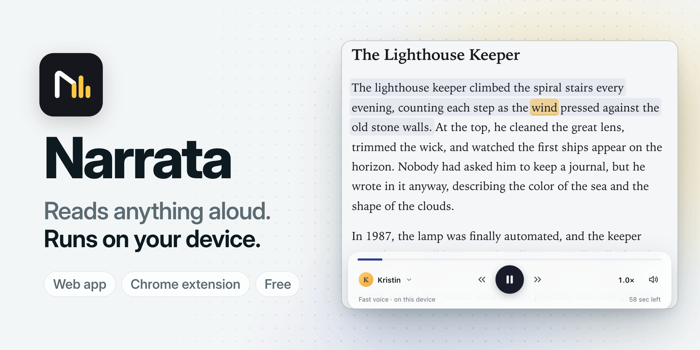
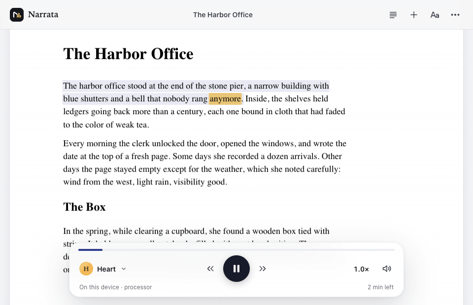
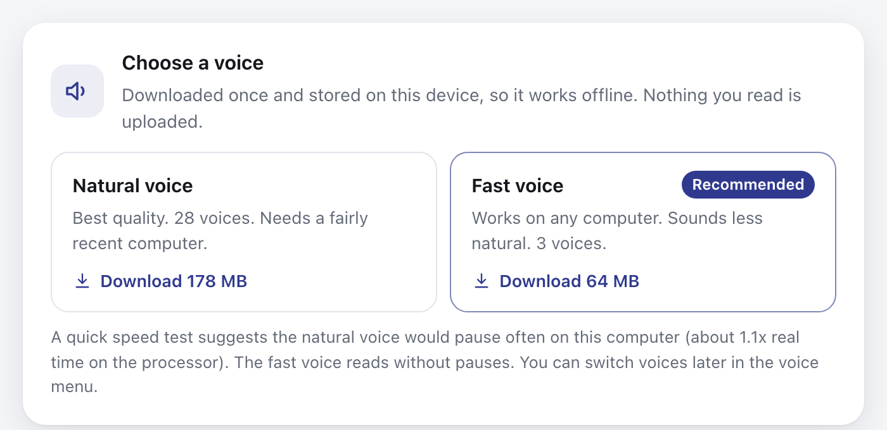
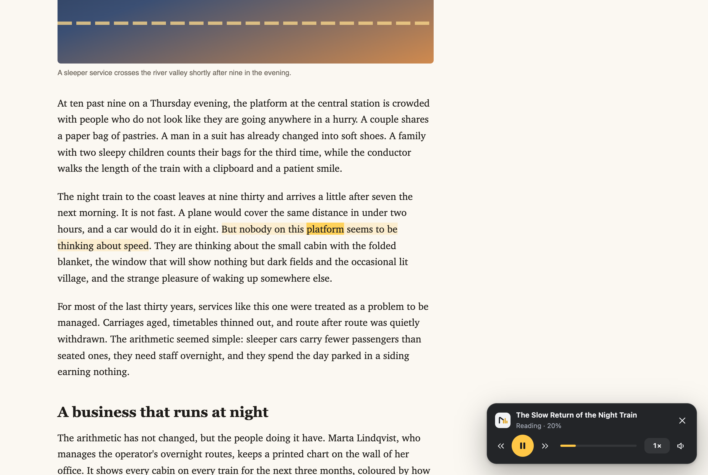

<picture>
  <source media="(prefers-color-scheme: dark)" srcset="docs/readme/narrata-banner-dark.png">
  
</picture>

<p align="center">
  <a href="https://kernel-hunter.github.io/narrata/">
    <picture>
      <source media="(prefers-color-scheme: dark)" srcset="docs/readme/open-narrata-dark.png">
      
    </picture>
  </a>
</p>

<p align="center">
  <a href="#chrome-extension">Chrome extension</a> ·
  <a href="#voices-and-licences">Voices</a> ·
  <a href="#privacy">Privacy</a>
</p>

**Narrata** reads PDFs, EPUBs, web pages and your own text aloud and highlights each word as it is spoken. The voice runs on your computer, in the browser: nothing you read is uploaded, there is no account, and after a one-time download it works offline. It is a free, open-source (MIT) alternative to Speechify, with a web app and a Chrome extension that reads the page you are on.



<p align="center"><sub>A PDF read aloud with the natural voice. The highlight follows the voice word by word.</sub></p>

## Get started

**Web app:** open [kernel-hunter.github.io/narrata](https://kernel-hunter.github.io/narrata/). Pick a voice, then try the sample, open a file or paste text. Nothing to install, though the browser can install it as an app.

**Chrome extension:** not in the Chrome Web Store yet. [Download it from the releases and load it](#chrome-extension) in a few steps.

<details>
<summary>Run it from the source</summary>

Requires Node.js 22 or newer and pnpm.

```sh
pnpm install
pnpm dev
```

Then open http://localhost:5330. See [Development](#development) for the other commands.

</details>

## Features

- **Word highlighting.** The word being read is highlighted and the page follows it. Click any word to start from there.
- **PDFs, EPUBs and web pages.** PDFs (on the original page, or as reflowed text), EPUB books, saved web pages, Markdown and text files, or text you paste.
- **Voices that run on your device.** 28 natural voices (American and British English) and 3 fast voices for older computers.
- **Speed from 0.5x to 3x.** The pitch stays natural.
- **Reading settings.** Reading font, size and line spacing, including the OpenDyslexic font. Light and dark themes.
- **Remembers your place.** Every document opens where you stopped.
- **Audio export.** Saves a document as an audio file (.m4a, or .wav where the browser cannot encode AAC).
- **Keyboard and media keys.** Keyboard shortcuts, media keys and lock screen controls. Can be installed as an app.

## How it compares

Speechify's column comes from its [pricing page](https://speechify.com/pricing/), checked on 30 October 2026.

| | Narrata | Speechify |
| --- | --- | --- |
| Price | Free | Free plan; Premium $139 a year or $29 a month |
| Voices | 28 natural and 3 fast, English only | Free: 10 "robotic sounding" voices. Premium: 1000+ natural voices, 60+ languages |
| Speed | Up to 3x | Up to 1.5x free, 5x Premium |
| Where it runs | Web app, Chrome extension (load unpacked for now) | iPhone, iPad, Android, Mac, Windows, web, Chrome and Edge extensions |
| AI summaries and chat | No | Premium |
| Source code | Open, MIT | Closed |

Speechify covers far more languages and devices. Narrata reads English only and runs on a computer, but it is free and your documents stay on that computer.

## Voices and licences

Before anything is downloaded, Narrata asks which voice you want:



| | Natural voice | Fast voice |
| --- | --- | --- |
| Model | [Kokoro-82M](https://huggingface.co/hexgrad/Kokoro-82M) | [Piper](https://github.com/rhasspy/piper) (Kristin, John, Cori) |
| Download | 178 MB (326 MB to run on the graphics chip) | 64 MB |
| Sound | Close to a human reader | Clear, but more synthetic |
| Needs | A computer from the last few years | Works on almost any computer |

It suggests one based on a quick look at your computer: the number of cores, the memory the browser reports, whether WebGPU is available, and a 0.2 second WebAssembly speed test. The speed test is calibrated against measurements of the natural voice on an Apple M5 laptop and on the same laptop slowed down by the operating system to about 2, 4 and 7 times slower (`scripts/bench/device-check.mjs`). It is an estimate, and you can switch voices at any time from the voice menu. Picking the fast voice downloads only that voice; the natural voice is downloaded only if you use it later.

If the natural voice turns out to be too slow while reading, Narrata offers once to switch to the fast voice.

| Voice | Licence | Notes |
| --- | --- | --- |
| Kokoro-82M, 28 English voices | Apache-2.0 | Run from the [ONNX export with word timestamps](https://huggingface.co/onnx-community/Kokoro-82M-v1.0-ONNX-timestamped), downloaded at runtime. |
| Piper Kristin and Cori | MIT | Trained from scratch by Bryce Beattie on public-domain [LibriVox](https://librivox.org/) recordings. |
| Piper John | MIT | Fine-tuned from Kristin, also public-domain LibriVox recordings. |

Most other Piper voices are fine-tuned from the "lessac" voice, whose recordings are licensed for non-commercial research only, so they are not offered. Piper normally needs eSpeak NG (GPL) to turn text into phonemes; Narrata uses its own phonemizer (a TypeScript port of misaki), so no eSpeak code or data is included. Narrata itself is MIT; see [NOTICE](NOTICE) for everything it includes.

## Privacy

Everything runs in your browser. The app downloads the voice you choose from Hugging Face the first time (and the other voice only if you pick it later). While it is open, it also checks the site it was loaded from for a newer version (a small `version.json` file), and offers to reload when there is one. Apart from that it makes no network requests of its own: no analytics, no server, no account. Your documents, reading positions and settings stay in the browser's storage (IndexedDB, local storage and the Origin Private File System) and are never uploaded. Clearing the site data in your browser, or **Remove voice data** under More, About and storage, deletes them.

## Chrome extension

The extension reads web pages where they are, highlights the word being spoken on the page and tints the sentence. It uses the same voices as the web app, running inside the extension.



It is not in the Chrome Web Store yet. To install it:

1. Download `narrata-extension-<version>.zip` from the [latest release](https://github.com/Kernel-Hunter/narrata/releases/latest) and unzip it into a folder you will keep.
2. Open `chrome://extensions`, turn on **Developer mode**, click **Load unpacked** and pick that folder.
3. On an article, click the Narrata button and choose **Read this page**, or press Alt+Shift+R. The first time, the player asks which voice to download.

To build it yourself instead, install [Node.js](https://nodejs.org/) 22 or newer and [pnpm](https://pnpm.io/installation), run `pnpm install` and then `pnpm build:ext` in this folder, and load the `dist-ext` folder.

**Updating.** Chrome does not update extensions loaded this way. When a new version is out, the Narrata popup says so. To update:

1. Download the new zip from the release page.
2. Unzip it and copy its files over your Narrata folder.
3. In `chrome://extensions`, click the reload button on Narrata.

Keep the same folder. Chrome ties an unpacked extension to its folder, so loading a different one, or removing the extension, starts over without your settings and the downloaded voice.

What it does:

- **Read this page** finds the article (with Readability, on a copy of the page) and reads it. The page itself is not modified: the highlight is drawn with the CSS Custom Highlight API.
- **Read selection** (Alt+Shift+S, or right-click) reads only the selected text. **Start reading from here** (right-click) starts at that paragraph.
- Click a word on the page to jump there. The page scrolls to follow the voice; scroll yourself and it stops until you press **Back to current**.
- The floating player has play and pause, previous and next sentence, speed and voice. Alt+Shift+P plays or pauses from anywhere. Shortcuts can be changed at `chrome://extensions/shortcuts`.
- Chrome does not let extensions read its own pages, the Web Store, or PDFs in its built-in PDF viewer. For PDFs and EPUBs, use the web app.

| Permission | Why |
| --- | --- |
| `activeTab` | Read the page you are on, only after you click the button, use a shortcut or the right-click menu. |
| `scripting` | Add the player and the highlight to that page. |
| `offscreen` | Run the voice model and play the audio in a hidden extension page. |
| `storage` | Remember your speed, voice and model choice. |
| `contextMenus` | The right-click entries. |

There are no host permissions. The extension's content security policy allows network connections only to Hugging Face, for the voice download, and to `api.github.com`, where the popup checks for a newer release at most once a day. The request sends nothing about what you read.

## Browser support

What was checked for this release (30 October 2026, macOS 27 on an Apple M5 laptop), and how:

| Browser | Result |
| --- | --- |
| Chrome for Testing 156 (Playwright) | Works. In the extension the natural voice ran on the graphics chip at 6.1x real time. |
| Chromium 152 (an Electron-based embedded browser) | Works. The service worker made the page cross-origin isolated (4 threads); WebGPU was detected. |
| Safari 27 | Unknown. Not tested: automating it needs a Safari setting changed. |
| Firefox, Edge, Chrome on Windows, Linux or Android | Unknown. Not tested for this release. Edge uses the same engine as Chrome. |

<details>
<summary>What was checked in each browser</summary>

- **Chrome for Testing 156 (Playwright).** Web app production build: natural voice on the processor, PDF page view with highlighting (the demo above), speed test calibration. Extension: the automated checks in `tests/e2e/verify-ext.mjs` and the first-run choice with a fresh profile.
- **Chromium 152 (an Electron-based embedded browser).** Web app, development server and production build served from `/narrata/` by a server that sends no isolation headers: first-run choice, fast voice download and reading, switching to a natural voice (download while the fast voice reads), a simulated graphics chip failure, Remove voice data.

</details>

If you try one of the untested browsers, an issue saying whether it worked (and which voice and device the About dialog shows) helps.

Narrata needs WebAssembly with SIMD. Several processor threads need cross-origin isolation, which the app's service worker provides on any static host, so it is not something you need to configure.

## Slower computers

How fast the natural voice runs depends on the computer. On an Apple M5 laptop it generates about 7 seconds of speech per second on the graphics chip, and 2 to 2.5 seconds per second on the processor with 4 threads. Below about 1x real time the natural voice cannot keep up with playback however much audio is buffered, and that is where the fast voice helps.

<details>
<summary>Measurements on emulated slower computers</summary>

Measured with `scripts/bench/cpu-bench.mjs`, with the browser slowed down by the operating system to emulate slower computers, reading the three-paragraph sample (about a minute of speech) at 1x on the processor:

| Emulated computer | Natural voice speed | Wait before audio | Pauses | Fast voice speed |
| --- | --- | --- | --- | --- |
| This laptop | 2.1x real time | 3.5 s | none | 29x real time |
| 2 times slower | 1.0x | 7.6 s | none | 14x |
| 5 times slower | 0.44x | 10 s | 5 (76 s in all) | 5.1x |
| 6 times slower | 0.34x | 10 s | 7 (111 s in all) | 3.7x |
| 17 times slower | 0.12x | 15 s | 7 (401 s in all) | 1.2x |

The emulation slows every core equally, so a real computer with more, slower cores may do better than the table suggests.

</details>

What the player does on a slow computer:

- If generation is a little faster than playback, the first chunks are kept short to build a lead.
- If it is slower, the player waits until it has enough audio to play to the end of the next minute without stopping (at most 10 seconds) and shows "Preparing audio" with an estimate.
- Chrome slows down hidden tabs. When playback is waiting for audio in a hidden tab, or while exporting, the player plays a tone far below hearing (20 Hz at -60 dB) so that generation keeps its full speed.

## How it works

- **Voice.** Kokoro-82M runs through [ONNX Runtime Web](https://onnxruntime.ai/) in a Web Worker: on the graphics chip with WebGPU when its output passes a check, otherwise on the processor with multi-threaded WebAssembly and an 8-bit version of the model. Every generated chunk is checked (NaN samples, clipping, audio that stops early), and if the graphics chip produces bad audio Narrata moves to the processor for good. The Piper voices run the same way on the processor.
- **Pronunciation.** Kokoro reads phonemes, not letters. Narrata converts English with a TypeScript port of [misaki](https://github.com/hexgrad/misaki), the converter Kokoro was trained with: its American and British dictionaries, its rules for endings and numbers, a small part-of-speech tagger for words spelled alike ("I read" and "I will read") and its neural network for unknown words. It also reads clock times, common abbreviations, units and web addresses. For Piper, the same phonemes are mapped to the symbols eSpeak would produce.
- **Word highlighting.** The models predict how long each phoneme lasts, and the converter knows which word each phoneme came from, so the highlight follows the voice word by word. Piper does not output these durations, so Narrata adds the output to the model graph when it loads it.
- **Speed without chipmunks.** Audio is generated at normal speed and played through [Signalsmith Stretch](https://signalsmith-audio.co.uk/code/stretch/), which keeps the pitch. All chunks go into one continuous buffer, so there are no gaps between sentences.
- **Storage.** Models are saved in the Origin Private File System, so later visits load them from disk in about a second. A service worker caches the app and adds the cross-origin isolation headers that multi-threaded WebAssembly needs, which is how it runs on static hosting such as GitHub Pages.
- **Documents.** [pdf.js](https://mozilla.github.io/pdf.js/) for PDFs, [Readability](https://github.com/mozilla/readability) for web pages, and a small EPUB reader built on [fflate](https://github.com/101arrowz/fflate).

## Development

Requires Node.js 22 or newer and pnpm.

```sh
pnpm install
pnpm dev              # http://localhost:5330
pnpm test             # unit tests (Vitest)
pnpm typecheck        # tsc --noEmit
pnpm build            # production build in dist/
pnpm preview          # serve dist/ on :5331
pnpm build:ext        # extension in dist-ext/
pnpm build:ext:test   # extension with test hooks
pnpm audit:licenses   # fails on GPL, LGPL or AGPL
```

`pnpm build:ext:test` builds the extension with hooks for automated checks, in `dist-ext-test/`. `node tests/e2e/verify-update.mjs` checks the web app's update notice against a local copy served the way GitHub Pages serves it, and `node tests/e2e/verify-ext-update.mjs` checks the one in the extension popup. `pnpm audit:licenses` checks the licences of everything the builds contain.

The production build uses relative paths, so `dist/` can be served from any path, such as `https://<user>.github.io/narrata/`. `.github/workflows/pages.yml` builds it and deploys it to GitHub Pages; `.github/workflows/ci.yml` runs the tests, type check, both builds and the licence audit on every push and pull request.

The version lives in `package.json`; `pnpm build:ext` copies it into the extension manifest. To publish the extension, bump it, then push a matching tag (`v0.2.0`): `.github/workflows/release.yml` builds the extension and attaches `narrata-extension-<version>.zip` to the GitHub release.

The G2P data in `src/engine/g2p/data/` is generated by the scripts in `scripts/g2p/`; each one explains its inputs at the top. `pnpm dev` and `pnpm build` copy the ONNX Runtime and pdf.js runtime files into `public/`, so the app never loads code from a CDN.

<details>
<summary>Measurement scripts</summary>

macOS, Playwright's Chromium (`pnpm exec playwright install chromium` once):

- `node scripts/bench/cpu-bench.mjs` measures the processor path under emulated slower computers: speed, time to first audio and pauses. Chrome's CPU throttling does not slow down Web Workers, so the script slows the browser's processes with the operating system instead.
- `node scripts/bench/device-check.mjs` checks the first-run speed test against the measured speed of the natural voice at the same emulated speeds.
- `node scripts/bench/background-check.mjs` compares generation speed in a visible and a hidden tab.
- `node scripts/bench/record-demo.mjs` records `docs/demo.gif` (needs ffmpeg).
- `node tests/e2e/verify-ext.mjs` loads `dist-ext-test/` into Chromium and checks reading, highlighting, speed, controls, selections, frames and restricted pages.

</details>

<details>
<summary>Project layout</summary>

```
src/core/    text model, sentence splitting
             and chunking, word alignment,
             timing, device decisions
src/docs/    readers for text, Markdown,
             HTML, EPUB and PDF
src/engine/  TTS worker, model storage
             (OPFS), device check, text to
             phonemes (g2p/), voices, Piper,
             export
src/audio/   playback engine and audio cache
src/ui/      reading views, player bar,
             menus and dialogs
src/store/   library (IndexedDB) and settings
src/pwa/     service worker and registration
extension/   browser extension: manifest,
             service worker, offscreen
             document, content script, popup
tests/       unit tests, fixtures and
             extension checks
```

</details>

## Contributing

Bug reports, fixes and small improvements are welcome. See [CONTRIBUTING.md](CONTRIBUTING.md) to send a change and [SECURITY.md](SECURITY.md) to report a security problem.

## Credits

- [Kokoro-82M](https://huggingface.co/hexgrad/Kokoro-82M) and [misaki](https://github.com/hexgrad/misaki) by hexgrad
- misaki's fallback networks by [Peter Reid](https://huggingface.co/PeterReid/graphemes_to_phonemes_en_us)
- [Piper](https://github.com/rhasspy/piper) by Michael Hansen, and the Kristin, John and Cori voices by Bryce Beattie
- [spaCy](https://spacy.io/) by Explosion, whose English tokenizer rules and tags Narrata's G2P reproduces
- [Project Gutenberg](https://www.gutenberg.org/) and [LibriVox](https://librivox.org/) for public-domain books and recordings
- [ONNX Runtime Web](https://onnxruntime.ai/) by Microsoft
- [pdf.js](https://github.com/mozilla/pdf.js) and [Readability](https://github.com/mozilla/readability) by Mozilla
- [fflate](https://github.com/101arrowz/fflate), [Signalsmith Stretch](https://signalsmith-audio.co.uk/code/stretch/) by Geraint Luff, [mp4-muxer](https://github.com/Vanilagy/mp4-muxer) by Vanilagy
- [OpenDyslexic](https://opendyslexic.org/) by Abbie Gonzalez (SIL Open Font License)

## Licence

MIT. See [LICENSE](LICENSE) and, for included third-party work, [NOTICE](NOTICE).
